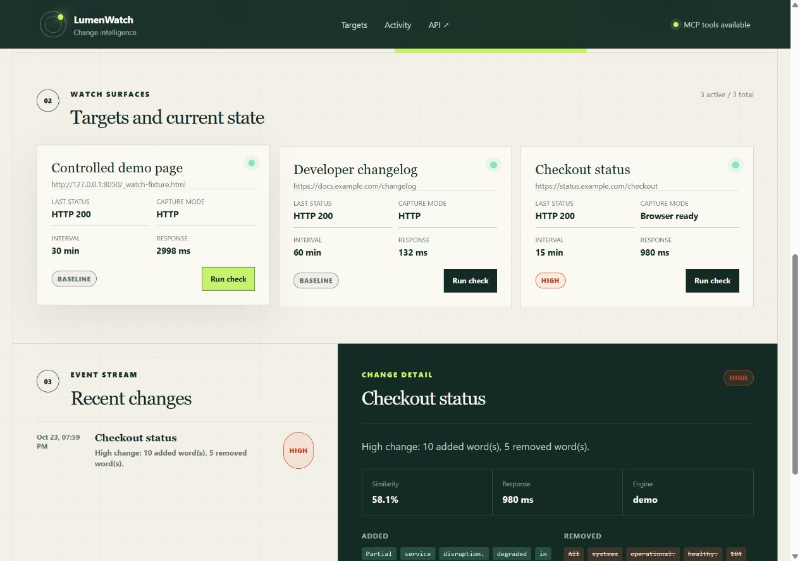
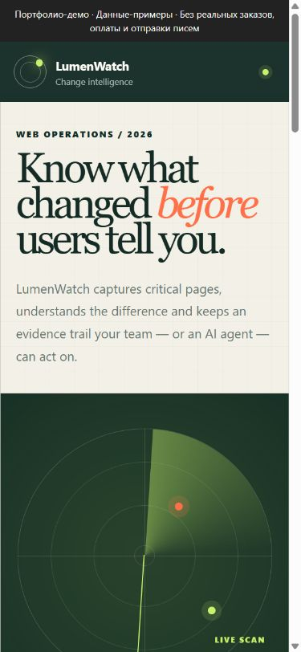

# LumenWatch — мониторинг изменений сайтов

Сохраняет версии страниц и показывает, что изменилось между проверками.

**Тип:** Самостоятельный портфолио-проект. Проект использовался реальными пользователями. В репозитории показана демонстрационная версия; масштаб и коммерческие показатели не заявляются.






[Короткая демонстрация сценария](docs/demo.gif)

## Что работает
- HTTP-захват, текстовые различия, история снимков и уровни изменений.
- Адаптивная панель, REST API, MCP-инструменты, опциональный планировщик.
- Опциональный захват JavaScript-страниц через Playwright.

## Стек
Python, FastAPI, HTTPX, Beautiful Soup, SQLite, Playwright, MCP.

## Запуск и проверка
Python 3.12. Для PostgreSQL-варианта — Docker или доступная PostgreSQL.

```bash
python -m venv .venv
# Windows: .venv\Scripts\activate
# Linux/macOS: source .venv/bin/activate
python -m pip install -e ".[dev]"
python -m ruff check .
python -m pytest -q
uvicorn app.main:app --host 127.0.0.1 --port 8020
```

## Технические решения
- Бизнес-логика общая для REST и MCP.
- Планировщик выключен по умолчанию; недоступная цель обрабатывается как отдельная ошибка.

## Границы готовности
- Начальные цели и пример изменения вымышлены.
- Анализ различий детерминированный: LLM не подключена. MCP — интерфейс инструментов, не автономный интеллект.
- Нет авторизации, многопользовательских рабочих пространств и защиты сетевого периметра для публичного сервиса. Запуск рассчитан на доверенные локальные цели.
- Browser mode требует отдельной установки Chromium; базовый прогон проверяет HTTP-сценарий.

## Подробности
[API, конфигурация и исходные инструкции](docs/TECHNICAL.md).

[Результаты проверки этой версии](docs/VERIFICATION.md).

[Пример запроса и ответа API](docs/API_EXAMPLE.md).
