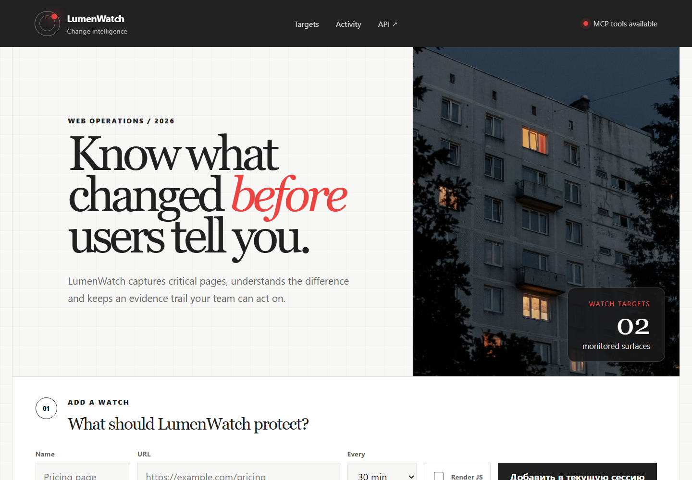
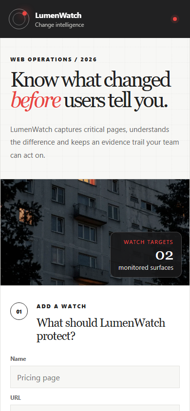

# LumenWatch - отслеживание изменений сайтов

Сохранение версий страниц, сравнение текста и история изменений в одном интерфейсе.

[Открыть проект](https://memorim.github.io/lumenwatch-website-monitor/)





## Возможности

- HTTP-снимки, извлечение текста, различия и уровни изменений.
- Адаптивная панель, REST API, MCP и необязательный планировщик.
- Необязательный захват JavaScript-страниц через Playwright.

## Стек и устройство

Python, FastAPI, HTTPX, Beautiful Soup, SQLite, MCP и необязательный Playwright.

## Ключевые решения

- REST и MCP используют общий сервис и слой хранения. Базовому HTTP-захвату не нужен браузер.
- Сохранённые версии позволяют проверить различия; сравнение выполняется по детерминированным правилам.

## Локальный запуск

Python 3.12.14, как в `.python-version`. Перед установкой зависимостей активируйте виртуальное окружение.

```bash
python -m venv .venv
# Windows: .venv\Scripts\activate
# Linux/macOS: source .venv/bin/activate
python -m pip install -c requirements-lock.txt -e ".[dev]"
uvicorn app.main:app --host 127.0.0.1 --port 8020
```

Команда запуска привязывает API к локальному адресу 127.0.0.1.

## Настройки

Доступные параметры перечислены в [.env.example](.env.example). Секреты храните вне Git. Порядок загрузки настроек и необязательные службы описаны в [технической документации](docs/TECHNICAL.md).

## Данные и обновления

Схема SQLite создаётся при запуске. Пути к базе и снимкам настраиваются; постоянные данные должны находиться вне временных каталогов сборки.

## Проверки

```bash
python -m pytest -q
python tests/check_contract.py
python tests/check_upgrade.py
python -m pip check
python -m ruff check .
```

Контролируемые HTTP/браузерные заглушки позволяют запускать pytest без внешних сайтов; также проверяются Ruff, OpenAPI, миграции и HTML-экранирование.

CI устанавливает зависимости по зафиксированным версиям и запускает настроенные проверки. Отдельная проверка документации находит неверные локальные ссылки и изображения. Проверка уязвимостей учитывает известные проблемы на момент запуска.

## Ограничения

- Режим без LUMENWATCH_PUBLIC_ORIGIN предназначен только для доверенного локального оператора и допускает приватные HTTP-цели. В публичном HTTP-режиме и изолированном браузере разрешены только публичные адреса.
- По умолчанию Compose публикует только 127.0.0.1:8020. Для внешнего доступа настройте защищённый режим и TLS-прокси по инструкции ниже. Это сервис одного оператора; отдельных аккаунтов клиентов нет.
- HTTP-захват ограничен 25 секундами, пятью редиректами и 2 MiB до разбора HTML. Сжатый ответ отклоняется даже при игнорировании Accept-Encoding: identity.
- Старый локальный браузер предназначен только для доверенных страниц. Для публичного режима обязателен одноразовый контейнер с отключённой сетью и лимитами ресурсов. Его необходимо проверить на целевом Docker-узле; GitHub Pages серверные проверки не выполняет.

## Документация

[Результаты аудита](docs/AUDIT_2026_10.md) · [Техническая документация](docs/TECHNICAL.md) · [Пример запроса и ответа](docs/API_EXAMPLE.md) · [История изменений](CHANGELOG.md)

## Версия в браузере

Открывается без установки. Изменения изолированы в памяти текущей вкладки и сбрасываются при перезагрузке. Серверные гарантии и SQLite относятся к локальному запуску, описанному выше.

Сборка: `python scripts/build_demo.py`. Проверка адаптера: `node --test demo/demo.test.mjs`.

В опубликованной версии можно изучить сохранённые отчёты и добавить запись в текущую сессию. Новые сетевые проверки и анализ GitHub выполняются серверной версией; браузерная страница их не имитирует.

### Защищённый HTTP API

Для публичного HTTP-мониторинга задайте LUMENWATCH_PUBLIC_ORIGIN (HTTPS origin) и случайный LUMENWATCH_AUTH_TOKEN длиной от 32 символов. Все маршруты, включая captures, требуют аутентификацию. API поддерживает Authorization: Bearer; браузерный вход использует HTTP Basic: имя `operator`, пароль — тот же `LUMENWATCH_AUTH_TOKEN`. Используйте TLS-прокси; токен не передаётся в URL. HTTP-захват проверяет адреса DNS на каждом переходе и соединяется с проверенным IP, сохраняя Host/SNI. Одновременно выполняются не более двух захватов на процесс.

Публичный браузерный захват разрешён только с явно настроенным изолированным worker, описанным ниже. Это режим одного оператора, не разделение пользователей. Веб-интерфейс открывается через встроенный запрос логина браузера; отдельный шлюз для добавления токена не нужен. Изменяющие запросы проверяют HTTPS Origin.

### Изолированный браузер для публичного режима

Соберите отдельный образ: `docker build -f worker/Dockerfile -t lumenwatch-browser:1.64.1 .`. На выделенном Linux-узле с Docker/cgroup v2 задайте `LUMENWATCH_BROWSER_ENABLED=true` и `LUMENWATCH_ISOLATED_BROWSER_IMAGE=lumenwatch-browser:1.64.1`. Публичный режим также требует HTTPS `LUMENWATCH_PUBLIC_ORIGIN` и случайный `LUMENWATCH_AUTH_TOKEN` от 32 символов. Без настроенного изолированного образа публичный запуск с браузером запрещён. Образ должен быть собран заранее: загрузка образов во время запроса отключена.

Каждый захват запускается в новом контейнере: сеть отключена на уровне Docker, корень доступен только для чтения, UID 1000, capabilities сброшены, no-new-privileges, память и swap вместе 768 MiB, одно CPU, 128 процессов, tmpfs 128 MiB. Каталоги, БД, секреты приложения и Docker socket в браузер не монтируются. Через 40 секунд контейнер принудительно удаляется; очистка выполняется и после успешного захвата. Docker CLI должен быть доступен серверу на выделенном узле; доступ к Docker daemon остаётся привилегированным и не должен выдаваться другим арендаторам.

HTTP-ресурсы поступают через ограниченный канал: только GET/HEAD, публичные IP и стандартные порты; DNS проверяется при каждом запросе, выбранный IP закрепляется в соединении. Прямые подключения браузера, включая обход перехвата, блокируются отсутствием сети. Лимиты: 64 запроса, 2 MiB на ресурс, 10 MiB суммарно, снимок 1440×1000 до 2 MiB. Service workers, WebSocket, скачивания, cookies и сжатые ответы не поддерживаются. Сайты, требующие входа, POST-запросов или ресурсов сверх бюджета, могут не пройти захват; ошибка не заменяется небезопасным локальным браузером.

Задание CI `isolated-browser` проверяет JavaScript-рендеринг через канал ресурсов и фактические ограничения контейнера: отсутствие сети, read-only, UID, capabilities, память, CPU и процессы. Перед размещением повторите `RUN_DOCKER_BROWSER_TESTS=1 python -m pytest tests/test_isolated_browser.py` на целевом узле.

## Размещение и снимки — 08.11.2026

Подготовлены бесплатные Docker Compose и Caddy-примеры для HTTPS, операторского токена и изолированного Playwright-контейнера. Проверка Docker-узла выполняется по [инструкции публичного размещения](docs/DEPLOYMENT_PUBLIC.md); платный хостинг не требуется при наличии собственного Docker-сервера.

Визуальный интерфейс не менялся; desktop/mobile снимки выше остаются актуальными и должны обновляться при следующем изменении UI.

## Проверка операторского доступа — 11.11.2026

Вход через браузер, сохранение Bearer API, отказ при неверном имени и проверка Origin подтверждены автоматическими тестами. [CI прошёл](https://github.com/memorim/lumenwatch-website-monitor/actions/runs/43032786501), включая существующую проверку изолированного браузера. Публичный HTTPS-адрес и сохранность на целевом Docker-узле ещё требуют сквозной проверки после размещения.
